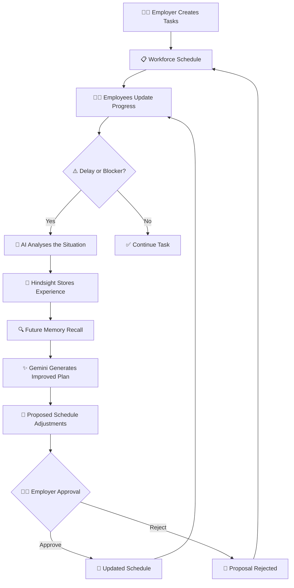
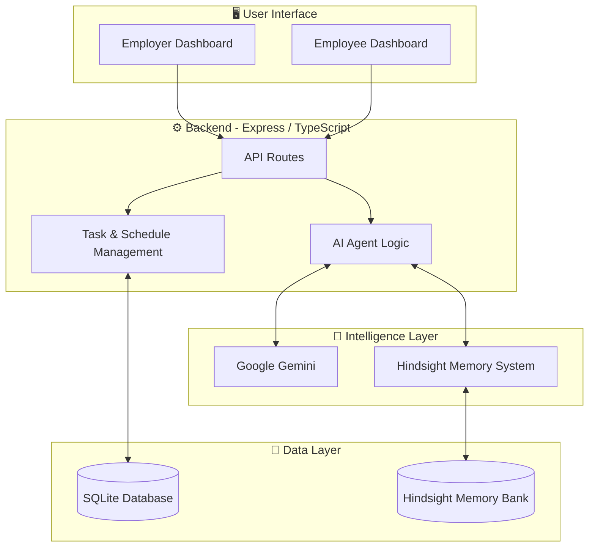

# ⚡ PactPulse AI
### Your Workforce. Your Commitments. Smarter Every Day.

<p align="center">
  <strong>An AI-powered workforce scheduling and recovery agent that learns from yesterday to plan better for tomorrow.</strong>
</p>

<p align="center">
  
  
  
  
  
</p>

---

## 🚀 What is PactPulse AI?

Workplaces deal with constantly changing schedules, unexpected delays, blocked tasks, and uneven workloads.

Traditional scheduling systems can assign tasks, but they often fail to learn from what went wrong previously.

**PactPulse AI is designed to change that.**

It is an intelligent workforce scheduling and recovery agent that helps employers and employees manage daily work while learning from previous workplace experiences.

Using **Google Gemini for AI reasoning** and **Hindsight for long-term memory**, PactPulse can remember previous delays, recall relevant experiences, and use those insights to recommend better schedules.

It doesn't just manage today's work. It learns from yesterday to make tomorrow better.

---

## 💡 The Problem

Imagine this situation:

- An employee is assigned a task expected to take 2 hours.
- The task takes 4 hours because another team hasn't completed a dependency.
- The schedule gets disrupted.
- The same type of task is assigned again the next day.
- The system repeats the same scheduling mistake.

Most basic scheduling systems don't retain useful context from these experiences.

**PactPulse AI aims to close this learning gap.**

## ✨ Our Solution

PactPulse introduces a memory-powered AI agent that:

- Understands task progress and workplace delays.
- Identifies blockers and scheduling conflicts.
- Remembers previous work experiences using Hindsight.
- Recalls relevant memories when planning future work.
- Recommends schedule adjustments and recovery strategies.
- Keeps employers in control through human approval.

---

## 🧠 How PactPulse AI Works

<p align="center">
  <strong>From workplace experience to intelligent scheduling</strong>
</p>



### The Hindsight Memory Advantage

Hindsight is the memory layer that helps PactPulse retain and recall useful workplace experiences.

For example:

**Yesterday's experience**

An employee's task was delayed because a required dependency was not completed on time.

**Memory retention**

PactPulse stores the relevant experience in Hindsight.

**Tomorrow's planning**

When a similar task is scheduled, PactPulse can recall the previous delay and consider it while generating a new plan.

**Result**

The AI can recommend additional time, better task ordering, or dependency checks.

This creates a learning loop:

> Experience → Memory → Recall → Reasoning → Better Decisions

Unlike a basic chatbot that starts each planning conversation without previous context, PactPulse uses retained experiences to inform future recommendations.

---

## 🎯 Key Features

### 👨‍💼 1. Employer Dashboard
- View workforce activity and task progress.
- Create and assign tasks.
- Monitor delays and blockers.
- Review AI-generated scheduling recommendations.
- Approve or reject proposed changes.

### 👩‍💻 2. Employee Dashboard
- View assigned tasks.
- Track task progress.
- Report delays and blockers.
- Share daily work updates.
- Stay informed about scheduling changes.

### 🤖 3. AI Scheduling Assistant
- Analyses current workload and task progress.
- Identifies potential scheduling problems.
- Generates recovery recommendations.
- Creates improved plans for upcoming work.

### 🧠 4. Hindsight-Powered Long-Term Memory
- Retains relevant workplace experiences.
- Recalls previous delays and blockers.
- Provides historical context for future planning.
- Helps the agent make more informed recommendations over time.

### 🔄 5. Schedule Recovery
- Detects disruptions in daily plans.
- Suggests alternative task arrangements.
- Recommends adjustments based on previous experiences.
- Keeps the employer involved in important decisions.

### 📊 6. Daily Work Review
- Reviews completed and pending tasks.
- Analyses delays and productivity patterns.
- Captures useful experiences for future planning.

---

## 🏗️ System Architecture



### Technology Stack

| Component | Technology |
|---|---|
| Frontend | React |
| Language | TypeScript |
| Backend | Node.js, Express |
| AI reasoning | Google Gemini |
| Long-term memory | Hindsight by Vectorize |
| Database | SQLite |
| Development | Vite |

---

## 🔍 Example: How PactPulse Learns

Consider a small company managing multiple employee tasks.

| Stage | What happens |
|---|---|
| Day 1 | A task takes longer due to an external dependency. |
| Memory | Hindsight retains the relevant experience. |
| Day 2 | A similar task is scheduled. |
| Recall | PactPulse retrieves the previous delay context. |
| Reasoning | Gemini considers the recalled experience. |
| Recommendation | The agent suggests a more realistic schedule. |
| Approval | The employer reviews and approves the proposal. |

**The important difference:** PactPulse doesn't simply react to delays. It uses retained experiences to inform future decisions.

---

## 🔐 Human-in-the-Loop AI

PactPulse is designed to assist people, not replace their decisions.

The AI generates recommendations, but the employer remains responsible for approving important scheduling changes.

This helps maintain transparency, accountability, and human control.

---

## ⚙️ Getting Started

### Prerequisites

- Node.js
- npm
- Google Gemini API key
- Hindsight API credentials

### Installation

```bash
# Clone the repository
git clone https://github.com/YOUR_USERNAME/PactPulse-AI.git

# Enter the project directory
cd PactPulse-AI

# Install dependencies
npm install
```

### Environment Configuration

Create a `.env` file in the root directory.

```env
GEMINI_API_KEY=your_gemini_api_key
APP_URL=http://localhost:3000

HINDSIGHT_API_KEY=your_hindsight_api_key
HINDSIGHT_API_URL=https://api.hindsight.vectorize.io
HINDSIGHT_BANK_ID=pactpulse-demo
```

Keep your real `.env` file private. Never commit API keys or credentials to GitHub.

### Run the Application

Use the development command configured in `package.json`.

For example, if the project defines `dev`:

```bash
npm run dev
```

Open the local URL shown in your terminal.

---

## 🌍 Impact and Future Scope

PactPulse aims to make workforce scheduling more adaptive and experience-driven.

Potential future improvements include:

- Predictive workload and delay analysis.
- Smarter task dependency detection.
- Employee workload balancing.
- Multi-team scheduling.
- Personalized scheduling insights.
- Advanced productivity analytics.
- More granular memory isolation across organizations.


<p align="center">
  <strong>⚡ PactPulse AI</strong><br/>
  Learn from yesterday. Plan smarter for tomorrow.
</p>
